# Conflicts

krabshell predicts where the aircraft in the air could be over the next
minute, finds the A5 cells where two or more of them could be together, and
works out what each should do to keep apart. The prediction and the
advisories come from the `sim-conflict` crate. The dashboard's
**Conflicts** screen and `GET /api/v1/conflicts` run it on the live world.
The advisories are shown, not flown: no drone changes course because of them.

This is a planning aid on a grid, not a certified collision avoidance system.
Its probabilities are only as good as the noise model and the performance
figures it is given.



*Figure 1. How an assessment runs. Resolving goes back to prediction: each
candidate manoeuvre is judged by predicting the aircraft again flying it.*

The figures on this page are drawn from the crate itself, by the `figures`
example; see [Regenerating the figures](#regenerating-the-figures).

## What is assessed

The assessment takes every aircraft in the air at the current tick:

- **Drones**, unless they are on the ground: a drone that is disarmed, idle or
  charging is left out.
- **Intruders**, always.
- **Manned aircraft** (the drones model's `aircraft` kind) while they fly
  their route; one parked between flights is left out.

For each it reads the position, altitude, airspeed (or ground speed if no
airspeed is published), heading (where the nose points), vertical speed and
callsign from the published state. Turn rate is taken as zero.

Each kind flies with a performance model built from the pack's params:

| Kind | Model | Cruise | Top speed | Climb, and advisory climb or descent |
|---|---|---|---|---|
| Drone | Multirotor | `cruise_ms` (10) | 1.5 × cruise, at least 18 m/s | `climb_ms` (3 m/s) |
| Intruder | Multirotor | `intruder_speed_ms` (12) | 1.5 × cruise, at least 18 m/s | `climb_ms` (3 m/s) |
| Manned aircraft | Fixed-wing | the generic narrow-body jet's | | |

The rest of a drone's or intruder's is the generic quadcopter's: 6 kg,
2.5 m/s descent, 3 m/s² acceleration, 60°/s yaw rate, 2 m/s² vertical
acceleration, a 500 m ceiling and 1 s between an advisory and starting to
follow it. A model's ceiling only caps climbs: an aircraft seen above it is
predicted from where it is, not pulled down to it.

The wind is the run's (see [Weather](weather.md)), looked up through the
weather cell above each point, at the simulation's UTC time plus the time
ahead. It is looked up once per substep for the middle of each aircraft's
cloud; each particle then adds its own wind error. A run with no weather is
predicted in still air.

Altitudes here are above mean sea level, as the drones report them. The wind
lookup takes that altitude as height above the ground, so over high terrain
the predicted wind is taken from higher up than the drones' own.

## How an aircraft is predicted

The reported state is not exact and no aircraft flies exactly straight. So
for each aircraft the predictor flies a cloud of 200 particles. Each starts
with its own small errors and wanders a little as it goes:

| Noise (one standard deviation) | Drones |
|---|---|
| Position | 5 m |
| Altitude | 2 m |
| Heading | 3° |
| Airspeed | 5 % |
| Vertical speed | 0.3 m/s |
| Turn-rate random walk | 0.05 °/s per √s |
| Airspeed random walk, level | 1 % per √s |
| Wind error, each way | 0.5 m/s |

Each particle flies the aircraft's energy model in 1 s substeps:

- A climbing aircraft (over 0.5 m/s up) keeps climbing at the rate the model
  gives for its altitude and speed, scaled to the rate it was seen climbing.
  A descending one does the same with idle power. A level one stays level.
- In a climb or descent it holds its speed schedule; level, it holds its
  speed, wandering a little.
- A turning aircraft keeps turning, within its turn rate.
- It moves through the air at its airspeed and heading, and the wind carries
  it.

The prediction looks 60 seconds ahead, in 12 steps of 5 seconds. At each step
every particle is put in its A5 cell and altitude layer, together with its
**protected zone**: one ring of neighbouring cells round its cell, and 15 m
above and below it. The probability that the aircraft is in a cell and layer
is the share of particles whose zone covers it. One aircraft therefore puts at
most 1 into any cell.



*Figure 2. One drone at 10 m/s in a gentle right turn, its 200 particles at
5, 20, 40 and 60 s ahead. Small errors in heading, speed and wind grow into a
cloud a few hundred metres across by the end of the minute.*



*Figure 3. That cloud 30 s ahead, counted into cells. Each particle covers
its cell and one ring round it, so at resolution 15, where the cloud is small
beside a cell, six cells hold 0.8 or more and three are all but certain. At
resolution 17 the zone is smaller than the cloud and the probability spreads
over 22 cells, none above 0.88.*

Particles are drawn from a generator seeded by a fixed seed and the
aircraft's id alone. The same aircraft gets the same cloud under every
manoeuvre tried for it, so manoeuvres are compared without sampling noise,
and the same world gives the same assessment, bit for bit, on every machine.

### Energy models

`sim-conflict` has two kinds of performance model, in
[`crates/sim-conflict/src/performance.rs`](../crates/sim-conflict/src/performance.rs).

- **Fixed-wing** aircraft use the Total Energy Model of EUROCONTROL's BADA 3,
  `(T − D) · V = m · g · dh/dt + m · V · dV/dt`. The excess power is split
  between climbing and accelerating by BADA's energy share factor for a
  constant-CAS or constant-Mach climb, below or above the tropopause. Thrust
  is a maximum-climb rating that lapses with air density and Mach; drag is a
  parabolic polar on the lift a level wing needs. Turns are flown at a set
  bank angle.
- **Multirotors** use the same idea in its simplest form: the climb rate
  available falls as forward speed takes more of the power, to half the
  hovering climb rate at top speed.

The energy model fixes the shape of the trajectory (a climb slows as the air
thins; a fast multirotor cannot also climb hard). The prediction scales it,
between 0.2 and 1.5 times, to the vertical speed the aircraft is actually
flying.

krabshell's drones and intruders are all multirotors. Its manned aircraft
(the drones model's `aircraft` kind) are assessed as the generic narrow-body
jet, on the drones preset's cells, layers and horizon, with their own
protected volume and the right of way (see above). Fixed-wing
aircraft are also used by the `airliners` preset, the tests and the example. No BADA or OpenAP
aircraft data is included: BADA's is licensed by EUROCONTROL and OpenAP's is
LGPL. `FixedWing`'s fields are named as OpenAP names them, so either source
can fill them. The generic narrow-body jet and quadcopter are illustrative.



*Figure 4. What the two generic models allow. The jet's curves step where its
speed schedule changes from constant CAS to constant Mach and again at the
tropopause, where BADA's energy share factor changes.*

## Cells and layers

A "cell" in the assessment is an A5 cell and an altitude layer.

**Altitude layers.** krabshell uses the drone preset's layers: 30 m deep,
counted up from mean sea level. Drones keep to the bottom few hundred feet,
so the airspace's standard 1 000 ft layers would put them all in one. With the
15 m vertical buffer a particle covers its own layer and, near a boundary,
the next one.

The `airliners` preset uses the airspace's layers instead: 1 000 ft deep below
FL290 and 2 000 ft from FL290 up, placed so no flight level sits on a
boundary. Below FL290 each layer is its level ±500 ft (FL100's is 9 500 to
10 500 ft). From FL290 each runs from 500 ft below its level to 1 500 ft
above (FL330's is 32 500 to 34 500 ft), since centring FL290's would overlap
FL280's. Aircraft at properly separated levels are therefore in different
layers.


*Figure 5. Altitude layers. Flight levels never sit on a boundary, so aircraft
at properly separated levels are in different layers. A drone exactly on a
30 m boundary covers the layers both sides of it.*

**Cell resolution.** The A5 resolution of the cells is chosen in this order:

1. The operator's choice, from the Conflicts screen or
   `PUT /api/v1/conflicts/settings`: 8 to 18.
2. The pack's `conflict_resolution` param, if it is 8 to 18. A value outside
   that range is ignored.
3. The world's occupancy resolution (15 in the bundled packs).

| Resolution | Cell edge, about |
|---|---|
| 8 | 23 km |
| 11 | 2.8 km |
| 12 | 1.4 km |
| 13 | 710 m |
| 14 | 360 m |
| 15 | 180 m |
| 16 | 89 m |
| 17 | 44 m |
| 18 | 22 m |

Finer cells tell apart aircraft that coarser ones lump together. The
protected zone is one ring of cells, so it shrinks with them: at resolution
15 it reaches about 180 m round an aircraft, at 18 about 22 m. Finer cells
also cost more to assess, since each particle's zone is counted into more,
smaller cells over the minute.

The operator's choice applies to every scenario until it is cleared or the
server restarts. Choosing the pack's (or world's) option on the screen, or
sending `null`, clears it.

## Probabilities and conflicts

At each step the probabilities every aircraft puts into a cell and layer are
summed. Two measures come from them.

- **Summed probability**: the number of aircraft expected in the cell. One
  aircraft alone gives up to 1.
- **P(two or more)**: the chance that two or more are there together, taking
  the aircraft as independent:
  `1 − Π(1 − pᵢ) − Σ pᵢ Π_{j≠i}(1 − pⱼ)`.

A cell and layer is **in conflict** at a step when at least two aircraft put
something into it and the summed probability reaches the threshold. The
threshold is 1: one aircraft's worth. It cannot be lower, or an aircraft
would be in conflict with itself.



*Figure 6. Two drones 1.2 km apart flying at each other at 60 m and 10 m/s,
the encounter in the `head_on` example. Each cell is shaded by the
probability both put in it, summed (the most likely layer of each cell is
shown). The first conflict is 40 s ahead.*

**Risk** sums, over every conflict, its summed probability weighted toward
the near ones: a conflict 30 seconds ahead counts half as much as one now,
since it leaves more time to act.

### Manned aircraft: protected volume and right of way

A manned aircraft carries a protected volume, its separation minima: by
default 300 m across and 150 m above and below, set with the pack's
`manned_lateral_m` and `manned_vertical_m`. A drone or intruder is in
conflict with it when one is predicted inside that volume. Against it, the
drone counts only the cell and layer it is in, not its own protected zone, so
the minima are 300 m and 150 m, not those plus the drone's ring of cells.
They hold to within the grid: a cell is in the volume when its centre is
within 300 m of the aircraft (cells at resolution 15 are about 180 m), and a
layer when any of it is within 150 m.

This is kept apart from drone-to-drone conflicts (a second plane of keys in
`sim-conflict`), so two drones inside an airliner's volume are each in
conflict with the airliner, not, on that account, with each other.

A manned aircraft also has the right of way: it is never advised. Drones and
intruders give way to it; a conflict nothing else can resolve is left
unresolved. Two manned aircraft in each other's volumes are always left
unresolved, as their separation is ATC's.

## Advisories

Advisories are chosen greedily, using the prediction itself as the judge.

1. With everyone carrying on as they are, find the conflicts.
2. For every aircraft in a conflict that has no advisory yet, try each
   manoeuvre it can fly, predict it again flying that manoeuvre, and score
   the risk left. Each manoeuvre is charged a cost, as a share of the risk,
   so that vertical manoeuvres are preferred, as in airborne collision
   avoidance.
3. Take the manoeuvre whose risk left, plus its cost, is lowest. Advise it
   only if that total is more than 2 % below the risk of carrying on, and
   commit that aircraft to it.
4. Go back to step 2 until nothing is in conflict, no manoeuvre helps, or 16
   advisories have been given.

Because the second aircraft is advised knowing the first's advisory, the two
come out complementary (one climbs, the other descends or holds) without a
separate coordination rule.



*Figure 7. The first round of the search for the encounter in figure 6. A
score is the risk left plus the manoeuvre's cost. Climbing and descending
both clear the conflict for either drone; UAV 1's climb is tried first and
wins the tie. Speeding up brings the meeting forward and makes things worse.*



*Figure 8. The result. After UAV 1's climb nothing is left in conflict, so
the search stops there and UAV 2 is given no advisory: risk 22.1 before,
0 after. Bands are the 5th to 95th percentile of the particles' heights.*

| Manoeuvre | Cost | What it asks for (drones) | Not offered when |
|---|---|---|---|
| Level off | 3 % | Vertical speed 0 | Already level (within 0.5 m/s) |
| Climb | 5 % | `climb_ms`, less in fast forward flight | At the 500 m ceiling, or already climbing at `climb_ms` |
| Descend | 5 % | `climb_ms`, or the 2.5 m/s descent limit if lower | Below 20 m above sea level, or already descending that fast |
| Turn left, turn right | 10 % | Heading 45° off the present one | |
| Speed up, slow down | 15 % | Airspeed 30 % more or less, within the envelope | The change would be under 0.5 m/s |

An advisory gives the aircraft, the manoeuvre and its target (a vertical
speed, a heading or an airspeed), the aircraft it was in conflict with, when
its first conflict was, the total risk before and after it, and whether the
aircraft is **clear** (in no conflict) once every advisory is followed.

**Unresolved conflicts.** Pairs still in conflict once every advisory is
followed are listed as unresolved, with when they first conflict and the
peak number of aircraft expected in a cell they share. They are what the
advisories could not fix, either because no single manoeuvre helped enough
or because the limit was reached.

**Not flown.** krabshell does not send the advisories to the drones, to a
ground station or over MAVLink or CoT. An operator who wants a drone to act on
one has to command it.

## When it runs

The assessment runs off the tick thread, on a blocking worker, and at most
once per published tick at a given resolution: a second request for the same
tick gets the same report. It runs only while someone is looking. A request
to the API or the Conflicts screen counts as a look; for 30 seconds after the
last one the server works it out again every 2 seconds in the background, so
the report is ready. A run nobody watches pays nothing for it.

Cost grows with the number of aircraft and with the number of aircraft in
conflict. Each aircraft costs one prediction (200 particles, 60 substeps), and
each aircraft in a conflict up to seven more, one per manoeuvre; a
manoeuvre's prediction is flown once however many rounds consider it. The
report gives the wall-clock time it took in `took_ms`, and the screen shows it
in its summary. For scale, the two-drone head-on encounter in the example
assesses in about a tenth of a second on a laptop:

```sh
cargo run --release -p sim-conflict --example head_on
```

## The Conflicts screen

The dashboard's **Conflicts** screen ([Dashboard](dashboard.md#conflicts))
has a map and two tables.

**Heatmap.** Every A5 cell any aircraft could be in over the next minute is
shaded at its highest, over every layer and step, so each aircraft's spread
is always there and overlaps stand out. The shading is from the predictions
with everyone carrying on as they are, not from the advised ones.

- **Shade by** chooses the measure: *Aircraft expected* (the summed
  probability), whose scale tops out at 2 or the highest shown, so one
  aircraft's certainty is mid-scale; or *P(two or more)*, from 0 to 100 %.
- Cells in conflict are outlined in red.
- The ten worst cells are numbered as in the table. Click a cell, or a row of
  the table, to pick it out in both.
- **Cells** chooses the resolution: the pack's or world's, or 8 to 18.
- The other map layers (drones, stations, geofences and so on) can be shown
  on top (see [Map](map.md)).

**Requests for conflict resolution.** One row per advisory: the aircraft,
what it is asked to do (for example "Climb at 2.5 m/s" or "Turn right to
135°"), who it was in conflict with, when its first conflict is, the total
risk before and after, and whether it clears it or leaves it still in
conflict. Unresolved pairs follow, marked *unresolved*.

**Top 10 A5 cells by conflict probability.** The cells two or more aircraft
could share, most aircraft expected first, each at its worst layer and step:
the cell, the layer's altitudes, how far ahead, the summed probability (tagged
*conflict* at the threshold), P(two or more), and each contributing aircraft
with its probability.

Above the tables a summary line gives the tick, the aircraft in the air, the
resolution and where it came from, the horizon and step, the threshold, and
how long the assessment took. The tables update every two seconds, and so
does the map.

## API

Both endpoints are under `/api/v1` and need the dashboard token (see
[API guide](api-guide.md)). The full reference is at [`/docs/api`](/docs/api).

| Method | Path | |
|---|---|---|
| GET | `/conflicts` | The assessment of the current tick. `?outlines=false` leaves out the cell outlines. |
| GET | `/conflicts/settings` | The cell resolution in use and where it came from. |
| PUT | `/conflicts/settings` | Choose the resolution, 8 to 18, or `null` for the pack's (or else the world's). |

```sh
T="Authorization: Bearer $DASHBOARD_TOKEN"

# The assessment, without outlines.
curl -s -H "$T" "localhost:8080/api/v1/conflicts?outlines=false"

# Just the advisories.
curl -s -H "$T" "localhost:8080/api/v1/conflicts?outlines=false" | jq '.advisories'

# The resolution in use.
curl -s -H "$T" localhost:8080/api/v1/conflicts/settings

# Assess on resolution 17 cells (about 44 m).
curl -s -H "$T" -X PUT localhost:8080/api/v1/conflicts/settings \
  -H 'content-type: application/json' -d '{"resolution": 17}'

# Go back to the pack's, or the world's.
curl -s -H "$T" -X PUT localhost:8080/api/v1/conflicts/settings \
  -H 'content-type: application/json' -d '{"resolution": null}'
```

The report from `GET /conflicts` has:

| Field | |
|---|---|
| `tick`, `sim_utc` | The tick assessed, and its UTC time if the run has weather. |
| `took_ms` | Wall-clock time the assessment took. |
| `aircraft` | Aircraft in the air that were assessed. |
| `resolution`, `resolution_from` | The cell resolution, and `operator`, `pack` or `world`. |
| `threshold`, `step_s`, `horizon_s`, `layer_m` | 1, 5, 60 and 30. |
| `risk_before`, `risk_after` | Total risk with everyone carrying on, and once every advisory is followed. |
| `advisories` | `id`, `callsign`, `manoeuvre` (`{"action": "climb"}` and so on), `targets` (`vs_ms`, `heading_deg` or `tas_ms`), `against`, `first_conflict_s`, `risk_before`, `risk_after`, `clear`. |
| `unresolved` | Pairs `a` and `b` still in conflict, with `first_s` and `peak_total`. |
| `cells` | Up to 500 cells two or more aircraft could share, most expected first, each with its `layer`, `alt_from_m`, `alt_to_m`, `t_s`, `summed`, `collision`, `conflict` and contributing `aircraft`. |
| `heat` | Up to 20 000 cells any aircraft could be in, each with its highest `summed` and `collision`. |

Times are simulated seconds ahead of the tick assessed. Altitudes are metres
above mean sea level. Each cell carries its `boundary` as `[lon, lat]` pairs
unless `outlines=false`.

`PUT /conflicts/settings` answers 400 for a resolution outside 8 to 18. Both
settings endpoints answer with the resolution in use, where it came from, the
world's resolution, the range allowed and the nominal cell edge in metres.

## Using `sim-conflict` directly

The crate has no krabshell dependencies beyond `sim-core`. `assess` takes a
list of `AircraftState`s, a fleet of named performance models, a wind source
and a `Config`, and returns the conflicts, encounters, advisories and the
conflicts left over. `Config::drones()` and `Config::airliners()` are the two
presets:

| | `drones()` (krabshell) | `airliners()` |
|---|---|---|
| Cells | Resolution 15, about 180 m | Resolution 11, about 3 km |
| Layers | 30 m | The airspace's |
| Vertical buffer | 15 m | 250 ft |
| Horizon | 60 s in 5 s steps | 300 s in 15 s steps |
| Turn advisory | 45° | 30° |
| Speed advisory | ±30 % | ±10 % |
| Lowest descent advisory | 20 m | 300 m |
| Urgency half-weight | 30 s | 120 s |

krabshell uses `drones()` with only the resolution changed. Source:
[`crates/sim-conflict/src`](../crates/sim-conflict/src), krabshell's use of it:
[`crates/sim-axum/src/conflicts.rs`](../crates/sim-axum/src/conflicts.rs).

### Regenerating the figures

The figures on this page are SVGs drawn from the crate's own output, so they
show what it does rather than a sketch of it. `Predictor::trace` predicts like
`Predictor::predict` and also hands back every particle at every step. The
`figures` example runs it on the scenarios above and prints the data as JSON;
[`tools/conflict_figures.py`](../tools/conflict_figures.py) draws them (Python's
standard library only):

```sh
cargo run --release -p sim-conflict --example figures > target/conflict-figures.json
python3 tools/conflict_figures.py target/conflict-figures.json docs/figures
```

Run them again after changing the predictor, the presets or the generic
performance models. The server compiles the figures in, so rebuild it to
serve the new ones.
