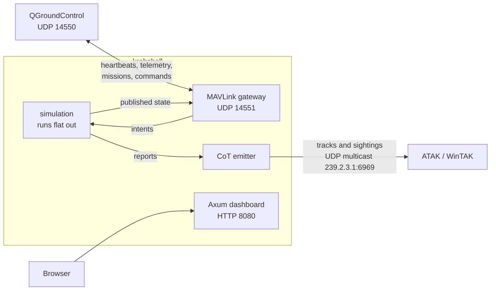

# Connecting QGroundControl and ATAK to krabshell

This guide gets a ground station flying krabshell's simulated drones, and a TAK
client showing what they see. It covers QGroundControl and ATAK/WinTAK, but
anything that speaks MAVLink 2 over UDP (MAVSDK, pymavlink, MAVProxy) or
Cursor-on-Target XML works the same way.

> **Status.** Both links have been tested end to end with pymavlink as the
> ground station and a Cursor-on-Target listener as the TAK client (the two
> scripts in [`tools/`](../tools)). They have not yet been tried with
> QGroundControl, WinTAK or ATAK. The steps below follow those programs'
> documented behaviour. If something differs, the
> [troubleshooting](#troubleshooting) section says what to check.

## How it fits together

`krabshell` is one process. Beside the Axum web server (the dashboard and REST
API) run two UDP services that make the simulated drones look real to outside
software:



- **MAVLink is not carried over HTTP.** The gateway lives in the same process
  as the Axum server but has its own UDP socket. The dashboard is for watching
  and controlling the simulation; the ground station talks UDP.
- **Every drone is its own MAVLink vehicle.** Its system id (`sysid`) is set in
  the scenario, and it uses component 1. They all share one UDP port, which is
  how QGroundControl expects several vehicles on one link.
- **krabshell answers for the drones.** It sends their heartbeats and telemetry
  and runs the mission handshake on the wall clock. The simulation behind it
  runs as fast as it can, not in real time. See
  [Simulation speed](#simulation-speed).
- **CoT is one-way.** krabshell sends to TAK clients and does not listen for
  anything they send back.

Every message, command, rate and timeout on both links is listed in
[protocols.md](protocols.md).

## Start krabshell

```sh
cargo run --release -p sim-axum --bin krabshell -- --scenario london-patrol --run
```

`london-patrol` has four drones:

| sysid | Callsign | Starts at | Behaviour |
|---:|---|---|---|
| 1 | HAWK-1 | Westminster | Patrols a loop from start-up |
| 2 | HAWK-2 | the City | Patrols a loop from start-up |
| 3 | HAWK-3 | South Bank | Patrols a loop from start-up |
| 4 | UAV-4 | Trafalgar Square | On the ground, disarmed: **yours to fly** |

It also has about 1 200 people, 150 vehicles, 10 named landmarks and one
intruder drone for the patrols to find.

The network options, with their defaults:

| Flag | Default | Meaning |
|---|---|---|
| `--mavlink-bind` | `127.0.0.1:14551` | Where krabshell listens for ground stations |
| `--mavlink-gcs` | `127.0.0.1:14550` | Where it sends telemetry before any ground station has spoken. Comma-separated for several. |
| `--mavlink-hz` | `5` | Position and attitude rate per drone |
| `--cot-dest` | `239.2.3.1:6969` | Where CoT goes: ATAK's multicast group, or any `host:port` |
| `--cot-ttl` | `1` | Multicast hops; 1 keeps it on the local network |
| `--cot-iface` | OS default | Local IPv4 address to send multicast from |
| `--no-mavlink`, `--no-cot` | off | Turn a service off |

Each has an environment variable too: `KRABSHELL_MAVLINK_BIND`,
`KRABSHELL_MAVLINK_GCS`, `KRABSHELL_COT_DEST` and `KRABSHELL_COT_IFACE`.

Run one krabshell at a time. A second one cannot bind the MAVLink port, and two
sending CoT to the same group give markers with the same ids, so TAK clients
show both worlds as one.

## Pick your network layout

The defaults suit software on **the same Linux machine** as krabshell. For
anything else, pick the row that matches and use its flags in place of the
defaults.

| Where krabshell runs | Where QGroundControl / TAK runs | What to do |
|---|---|---|
| Linux | Same machine | Nothing: the defaults work. |
| WSL2, default (NAT) networking | Windows, same PC | Point both services at the Windows host (below). |
| WSL2 with mirrored networking | Windows, same PC | The defaults should work (see below). |
| Any | Another machine, phone or tablet on the LAN | Bind MAVLink to all interfaces and address the other device. |

### WSL2 with NAT (the WSL default)

In this mode WSL has its own network behind Windows. UDP sent to `127.0.0.1`
in WSL does not reach Windows programs, and multicast does not leave WSL. Send
to the Windows host's address instead, which is WSL's default gateway:

```sh
WIN=$(ip route show default | awk '{print $3}')    # e.g. 172.23.144.1
cargo run --release -p sim-axum --bin krabshell -- --scenario london-patrol --run \
  --mavlink-bind 0.0.0.0:14551 \
  --mavlink-gcs "$WIN:14550" \
  --cot-dest "$WIN:4242"
```

That address can change when WSL restarts, so look it up each time. The first
time a Windows program receives on these ports, Windows Firewall asks whether
to allow it. Allow it on private networks.

### WSL2 with mirrored networking

Mirrored mode shares Windows' network interfaces with WSL, so `127.0.0.1`
means the same thing on both sides. Create or edit
`C:\Users\<you>\.wslconfig`:

```ini
[wsl2]
networkingMode=mirrored
```

Then run `wsl --shutdown` from Windows and open WSL again. The default flags
should now reach QGroundControl and WinTAK on the same PC. Multicast support in
this mode depends on the Windows build; if TAK shows nothing, use a unicast
`--cot-dest` as in the NAT recipe.

### Another device on the network

```sh
cargo run --release -p sim-axum --bin krabshell -- --scenario london-patrol --run \
  --mavlink-bind 0.0.0.0:14551 \
  --mavlink-gcs <gcs-ip>:14550 \
  --cot-dest 239.2.3.1:6969          # or <tak-device-ip>:4242
```

krabshell logs a warning when MAVLink is bound beyond loopback. MAVLink has no
authentication, so anything that can reach the port can arm and fly the
drones. Only do this on a network you trust.

## QGroundControl

### 1. Connect

QGroundControl listens for vehicles on UDP 14550 by default
(**Application Settings → General → AutoConnect to the following devices →
UDP** is on). krabshell sends there, so with the right flags for your layout,
the vehicles appear shortly after QGroundControl starts.

If they don't, or auto-connect is off, add the link by hand:

1. **Application Settings → Comm Links → Add**.
2. **Type:** UDP. **Port:** 14550.
3. Under **Server Addresses**, add krabshell's host and port, e.g.
   `127.0.0.1:14551`, or the WSL or LAN address in the other layouts.
4. **OK**, then select the link and press **Connect**.

Adding the server address makes QGroundControl speak first. krabshell then
sends that peer everything, even without `--mavlink-gcs`.

### 2. What you should see

- **Four vehicles** in the vehicle selector at the top of the Fly view. Each
  appears as a generic quadrotor (krabshell reports `MAV_AUTOPILOT_GENERIC`).
- **HAWK-1 to 3 armed and moving; UAV-4 disarmed** at Trafalgar Square.
- **Messages about parameters or components are expected.** krabshell
  exposes a single parameter (`SYSID_THISMAV`) and no component metadata,
  which QGroundControl reports and then carries on.

### 3. Fly UAV-4 on a mission

1. Select **UAV-4** in the vehicle selector.
2. In the **Plan** view, add a **Takeoff** item, a few **Waypoints**, and
   **Return** or **Land** at the end. Keep altitudes in the relative (default)
   frame. Every waypoint must be inside the scenario's world, which for
   `london-patrol` is a region of southern England. A mission with a point
   outside it is rejected, and the reason appears as a message in
   QGroundControl.
3. Press **Upload**. krabshell answers with `MISSION_ACK` once the simulation
   has the mission, so a later **Download** returns exactly what was uploaded.
4. In the **Fly** view, **Arm** the vehicle, then **Start Mission**.
   QGroundControl shows the current waypoint advancing.

Commands that work from the Fly view:

| Action | MAVLink command |
|---|---|
| Arm / Disarm | `COMPONENT_ARM_DISARM` (400); disarming in flight is refused unless forced |
| Takeoff | `NAV_TAKEOFF` (22) |
| Start Mission | `MISSION_START` (300) |
| Pause / Continue | `DO_PAUSE_CONTINUE` (193) |
| Go to location | `DO_REPOSITION` (192) |
| Return | `NAV_RETURN_TO_LAUNCH` (20) |
| Land | `NAV_LAND` (21) |
| Set mission item | `DO_SET_MISSION_CURRENT` (224), `MISSION_SET_CURRENT` |
| Mode change | `DO_SET_MODE` (176), `SET_MODE`. Auto starts the mission; anything else holds position. |

krabshell also answers the requests QGroundControl makes when it connects
(`REQUEST_MESSAGE` for `AUTOPILOT_VERSION` and `HOME_POSITION`,
`REQUEST_AUTOPILOT_CAPABILITIES`, `SET_MESSAGE_INTERVAL`). Anything else is
answered with `MAV_RESULT_UNSUPPORTED`. The parameters each command takes, and
when it is refused, are in [protocols.md](protocols.md#commands).

The drone flies these mission items:

| Item | Id | Notes |
|---|---:|---|
| `NAV_TAKEOFF` | 22 | Climbs straight up to the item's altitude. On the ground, waits (charging on its home pad) until the battery reaches `launch_battery_pct`, or param2 percent if that is higher and it is on a charger (a krabshell extension) |
| `NAV_WAYPOINT` | 16 | param1 hold time (s), param2 acceptance radius (m) |
| `NAV_LOITER_UNLIM` | 17 | Holds until you change mode or item |
| `NAV_LOITER_TIME` | 19 | param1 seconds |
| `NAV_RETURN_TO_LAUNCH` | 20 | Climbs to `rtl_alt_m`, flies home, lands, disarms |
| `NAV_LAND` | 21 | Lands at the item's position, or where it is if 0,0: on the home pad within 10 m of home, on the terrain elsewhere. Stays armed if more items follow (loading, a takeoff); disarms if it is the last |
| `CONDITION_DELAY` | 112 | param1 seconds |
| `DO_JUMP` | 177 | param1 target item, param2 repeats (−1 forever) |
| `DO_CHANGE_SPEED` | 178 | param2 metres per second |
| `DO_WINCH` | 42600 | Holds position while the winch runs. param2 `WINCH_DELIVER` (4) lowers from the drone's height, releases, reels up and locks, timed by the `winch_*` params; `WINCH_RELATIVE_LENGTH_CONTROL` (1) takes \|param3\| m at \|param4\| m/s. Other actions complete instantly |

Other items (camera, gimbal, servo) complete instantly, so a mission containing
them still runs. Rally points are not simulated: uploading an empty rally
plan succeeds, and a non-empty one is refused.

Geofences are simulated, and the fence plan works both ways. In the **Plan**
view, the **Fence** tab shows every geofence open (each circle a
`NAV_FENCE_CIRCLE_EXCLUSION`, each polygon corner a
`NAV_FENCE_POLYGON_VERTEX_EXCLUSION`); `MISSION_CURRENT.fence_id` changes
whenever one opens or closes. Draw circular or polygon **exclusion** fences
there and **Upload**: they open at once, and the drones the simulation flies
route round them. The upload is the whole set of fences ground stations set:
a fence you delete and re-upload without closes, and clearing the fence plan
closes all of yours. The scenario's fences, and those drawn on the
dashboard, come down with the plan and go back up unchanged; deleting one in
QGroundControl does not close it (the dashboard's Geofences tab does). Inclusion fences are not simulated, and
a plan with one is refused with a message saying so. A fence over a drone's
pad is refused too. Fences apply to every drone, not just the vehicle the
plan was uploaded to.

A drone you fly is not rerouted for you: fly it into a fence and the breach
is logged.

Altitudes are above mean sea level. A pack can carry terrain (see the README);
without it the ground is flat at 0 m. A drone's home is the pad it starts on,
which can be a rooftop above the terrain. Mission altitudes follow the item's
frame: relative to home (3, 6, QGroundControl's default), above mean sea level
(0, 5), or above the terrain under the drone (10, 11), which makes the drone
follow the ground along the whole leg. `GLOBAL_POSITION_INT` reports `alt`
above sea level and `relative_alt` above home.

On its home pad a drone charges at `charge_pct_s` (if the pack sets it), armed
or not.

### Flight modes

krabshell reports its own mode numbers in the heartbeat's `custom_mode`.
QGroundControl's generic-autopilot support may show them as numbers rather
than names:

| custom_mode | Mode |
|---:|---|
| 0 | Disarmed |
| 1 | Idle (armed, on the ground) |
| 2 | Takeoff |
| 3 | Auto (flying the mission) |
| 4 | Loiter (holding position) |
| 5 | Goto (flying to a repositioned point) |
| 6 | RTL |
| 7 | Land |

The numbers are for display only. A mode change from QGroundControl only
looks at whether the Auto flag is set: with it, the drone starts its mission;
without it, a drone in the air holds position. Use **Return** or **Land** to
bring a drone down. See [protocols.md](protocols.md#modes).

## ATAK, WinTAK and iTAK

### What arrives

| On the map | CoT type | When |
|---|---|---|
| The four drones, as friendly UAVs | `a-f-A-M-H-Q` | Once a second, with heading, speed, mode and battery in the remarks |
| People a drone saw | `a-u-G-U-C-I` | When seen; again at most every `report_interval_s` (15 s in `london-patrol`) |
| Vehicles a drone saw | `a-u-G-E-V` | As above |
| The intruder drone | `a-u-A-M-H-Q` | As above |
| Landmarks | `b-m-p-s-m` spot markers | Every 15 s |

Every uid starts with `krabshell-`. Drones are `krabshell-uav-<sysid>`,
landmarks `krabshell-poi-<id>` and sightings `krabshell-det-<id>`, and
each links to the drone that made it. The remarks say who saw it, at what
range, and the simulation tick. Events are stamped with real time, so a
sighting stays on the map for 30 s after the last report, a drone for 10 s
and a landmark for 10 minutes. The full event format is in
[protocols.md](protocols.md#cursor-on-target).

### Option A: the default multicast (same network, no setup)

ATAK and WinTAK listen on the SA multicast group `239.2.3.1:6969` out of the
box. If the TAK device is on the same network segment as krabshell (the same
Linux machine, or WSL in mirrored mode), leave `--cot-dest` at its default and
the markers appear. Multicast normally doesn't cross routers, VPNs or WSL's NAT.
Raise `--cot-ttl` only if you know you need more hops.

### Option B: unicast to a UDP input (works through NAT)

1. In the TAK client, add a UDP input. In ATAK and WinTAK this is
   **Settings → Network Preferences → Network Connection Preferences → Manage
   Inputs → + (add)**. Protocol **UDP**, a free port such as **4242**, and a
   name like `krabshell`. Menu names differ slightly between versions and
   between ATAK, WinTAK and iTAK.
2. Start krabshell with `--cot-dest <tak-device-ip>:4242`:
   - **WinTAK on the same PC as WSL (NAT):** use the Windows host address from
     the [WSL recipe](#wsl2-with-nat-the-wsl-default).
   - **ATAK on a phone:** use the phone's Wi-Fi address. The phone and the
     computer must be on the same network, and the phone must be able to
     receive from it (guest Wi-Fi often blocks this).
3. Allow the TAK client through the firewall on Windows if prompted.

### Option C: through a TAK Server

TAK Server can take plain CoT on a UDP input, which it then shares with
everyone connected to it. Point `--cot-dest` at that input, e.g.
`--cot-dest takserver.example:8087` if your server's CoreConfig defines a UDP
input on 8087. krabshell does not speak TAK Server's TLS streaming protocol.

## Simulation speed

The simulation is never slowed down for these links. `london-patrol` runs about
two hundred times faster than real time, so in QGroundControl and ATAK the
drones fly very fast, and a mission finishes in seconds. Telemetry always shows
where the simulation is now; nothing is queued or replayed.

To watch at real speed, go to the dashboard's **Run** page and set **Speed**
to **Real time**. The packs use 0.1 s per tick, so real time is 10 ticks a
second. You can also use the rate API:

```sh
curl -X POST localhost:8080/api/v1/run/rate -H 'content-type: application/json' -d '{"target_tps": 10}'
```

While the simulation is **paused**:
- Heartbeats and telemetry keep flowing, frozen in place.
- Commands are refused with `MAV_RESULT_TEMPORARILY_REJECTED` and the message
  "Simulation is paused".
- A mission upload is accepted, with the message "Mission queued: simulation
  paused", and takes effect on the next tick. A fence plan upload is treated
  the same way ("Fence plan queued: simulation paused").

## Checking without QGroundControl or ATAK

Two scripts in [`tools/`](../tools) stand in for the real clients. They are
the quickest way to tell a network problem from an application one.

```sh
uv run tools/mavlink_check.py                  # lists drones, flies UAV-4 round a square, lands
uv run tools/mavlink_check.py --sysid 2 --listen 0.0.0.0:14550
python3 tools/cot_listen.py                    # prints each CoT event as it arrives
python3 tools/cot_listen.py --only a-u-A-M-H-Q # just intruder sightings
```

No virtual environment is needed. `mavlink_check.py` declares its one
dependency (pymavlink) in an inline `# /// script` block, and `uv run` builds a
cached, throwaway environment from it on first use. `cot_listen.py` uses only
the standard library. To use a venv of your own instead:
`uv venv && uv pip install pymavlink && .venv/bin/python tools/mavlink_check.py`.

Both must run where krabshell's traffic arrives: `mavlink_check.py` listens on
krabshell's `--mavlink-gcs` address, and `cot_listen.py` joins the multicast
group, or takes `--unicast PORT`. Only one program at a time can listen on
UDP 14550, so close QGroundControl before running the MAVLink check on the
same machine.

The same sightings are available as JSON from the dashboard's API:

```sh
curl -s 'localhost:8080/api/v1/reports?since=0' | head -c 600
curl -s 'localhost:8080/api/v1/state/entities?kind=drone'
```

## Troubleshooting

| Symptom | Likely cause and fix |
|---|---|
| krabshell exits with "could not bind the MAVLink gateway" | Another krabshell (or another program) holds UDP 14551. Stop it, or use `--mavlink-bind 127.0.0.1:14571`. |
| No vehicles in QGroundControl | Telemetry isn't reaching it. Check `--mavlink-gcs` points at QGroundControl's machine and port 14550, and the Windows Firewall prompt was allowed. Run `tools/mavlink_check.py` on that machine to confirm packets arrive. |
| Vehicles appear but uploads time out | QGroundControl's replies aren't reaching krabshell. Bind with `--mavlink-bind 0.0.0.0:14551` when QGroundControl is on another host or in Windows under WSL NAT, and make sure nothing blocks UDP 14551 inbound. |
| Upload refused: "item N is outside the world" | A waypoint lies outside the scenario's region. Keep the mission near the drones. |
| Commands refused: "Simulation is paused" | Start the simulation from the dashboard, or run krabshell with `--run`. |
| Drones move far too fast | Expected; see [Simulation speed](#simulation-speed). Set 10 tps for real time. |
| Nothing in ATAK or WinTAK | Multicast isn't crossing to the device: use a unicast UDP input (Option B). Check with `tools/cot_listen.py` on the TAK machine or next to krabshell. |
| Markers jump between two positions | Two krabshell processes are sending CoT. Stop one. |
| The patrol drones never land | `london-patrol` gives them unlimited battery (`battery_drain_pct_s = 0.0` in its `params.toml`). Set a drain to see low-battery returns. |
